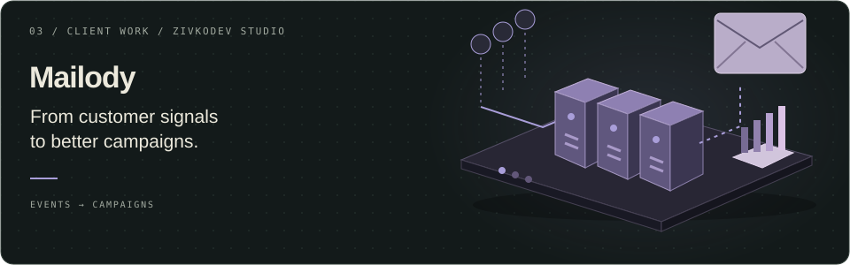
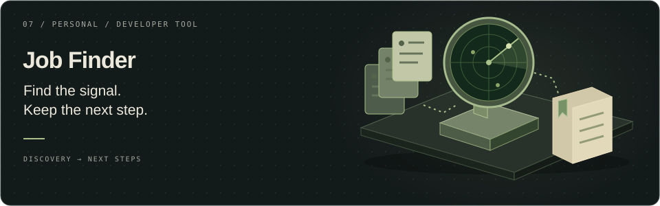

<a href="https://zivko.dev">
  <picture>
    <source media="(prefers-reduced-motion: reduce)" srcset="./assets/banner-still.png">
    
  </picture>
</a>

  <a href="https://zivko.dev">zivko.dev</a> ·
  <a href="https://cekira.com">cekira.com</a> ·
  <a href="https://linkedin.com/in/zivko-ostojic">LinkedIn</a> ·
  <a href="mailto:contact@zivko.dev">contact@zivko.dev</a>

Hi, I'm Zivko. I build web apps from the database all the way to the UI, mostly with TypeScript, React and Node. Frontend is where I started, and it's still the part I enjoy most.

## Things I've built

A mix of my own products and work I've done with client teams.

<a href="https://cekira.com">
  <picture>
  <source media="(max-width: 600px)" srcset="./assets/workbench-cekira-mobile.svg">
  
</picture>
</a>

**[Cekira](https://cekira.com)** · My app for tracking work and sending invoices. I built the work logs, PDF templates, workspace permissions, Stripe billing, and AI imports with a review step.

TypeScript · Next.js · tRPC · PostgreSQL · Stripe

 

<a href="https://zivko.dev">
  <picture>
  <source media="(max-width: 600px)" srcset="./assets/workbench-portfolio-mobile.svg">
  
</picture>
</a>

**[zivko.dev](https://zivko.dev)** · My portfolio as an explorable 3D scene, with an interactive retro terminal inside. A place to work on lighting, shaders, interaction, and the details that make the web feel different.

TypeScript · React · Three.js · React Three Fiber

 

<picture>
  <source media="(max-width: 600px)" srcset="./assets/workbench-mailody-mobile.svg">
  
</picture>

**Mailody** · Built analytics dashboards, attribution reporting, and async data pipelines. On the AI email product, I worked on customer profiling, campaign generation, and background workers.

React · Python · FastAPI · Celery · Redis · PostgreSQL

 

<picture>
  <source media="(max-width: 600px)" srcset="./assets/workbench-gaiseo-mobile.svg">
  
</picture>

**Gaiseo** · Worked across the frontend, backend, and architecture: website crawling and scoring, LLM integrations, subscription flows, and Azure infrastructure.

TypeScript · React · Node.js · PostgreSQL · Azure

 

<picture>
  <source media="(max-width: 600px)" srcset="./assets/workbench-conga-mobile.svg">
  
</picture>

**Conga** · Developed an enterprise UI component library shared across products. I led reusable data-grid and table work, built React and Lit components, and documented their behavior in Storybook.

TypeScript · JavaScript · React · Lit · Storybook

 

<picture>
  <source media="(max-width: 600px)" srcset="./assets/workbench-deepdays-mobile.svg">
  
</picture>

**Deepdays** · Frontend and mobile work on Deepdays / ClubKit, with backend contributions. I built event and ticket screens, organizer tools, interactive partner maps, and Capacitor integrations for Android and iOS.

React · TypeScript · Capacitor · Google Maps API · MongoDB

 

<picture>
  <source media="(max-width: 600px)" srcset="./assets/workbench-job-finder-mobile.svg">
  
</picture>

**Job Finder** · My personal job-search tool. I built CV import and review, sourced discovery with fit explanations, and saved-job and application tracking with drafts and follow-ups.

TypeScript · Next.js · SQLite · OpenRouter

### Tools I work with

**Web** · TypeScript, React, Next.js, Lit  
**Backend & data** · Node.js, Python, FastAPI, PostgreSQL, Redis, MongoDB  
**Delivery & creative** · Docker, GitHub Actions, Azure, Storybook, Capacitor, Three.js, React Three Fiber

---

Based in Serbia · Working remotely · Open to new roles  
[Let's talk](mailto:contact@zivko.dev) · [Explore my portfolio](https://zivko.dev)
