<a href="https://zivko.dev">
  <picture>
    <source media="(prefers-reduced-motion: reduce)" srcset="./assets/banner-still.png">
    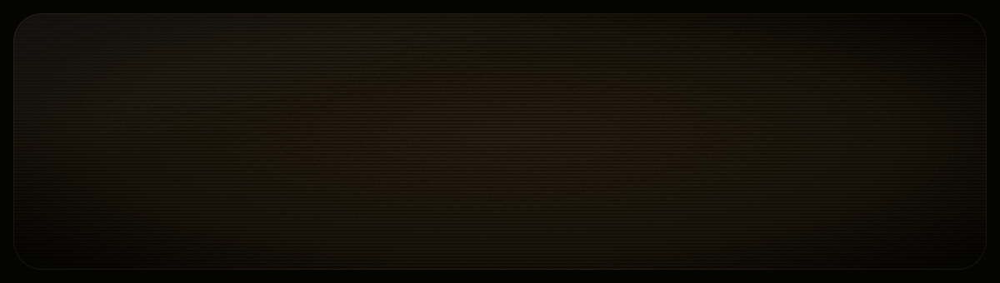
  </picture>
</a>

  <a href="https://zivko.dev">zivko.dev</a> ·
  <a href="https://cekira.com">cekira.com</a> ·
  <a href="https://zivko.dev/resume.pdf">CV (PDF)</a> ·
  <a href="https://linkedin.com/in/zivko-ostojic">LinkedIn</a> ·
  <a href="mailto:contact@zivko.dev">contact@zivko.dev</a>

Hi, I'm Zivko. I build web apps from the database all the way to the UI, mostly with TypeScript, React and Node. Frontend is where I started, and it's still the part I enjoy most.

  
<strong>Studio notes</strong> 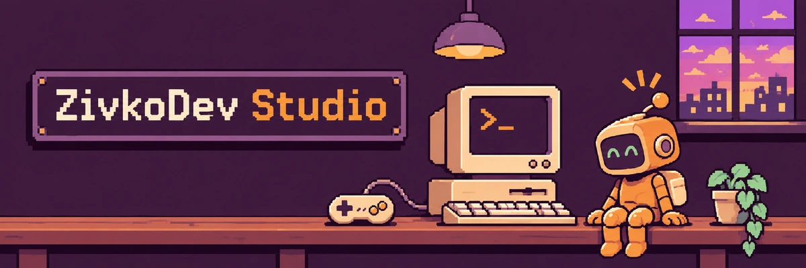

My curiosity started early with computers and games — not just playing them, but understanding how a machine could create worlds on a screen.

At ZivkoDev Studio I build client applications and SaaS products, from the first technical spec to testing and production.

## Things I've built

A mix of my own products and work I've done with client teams.

Select a sketch to see the stack.

### Independent projects

<table>
  <tr>
    <td width="50%" valign="top">
      

        
<strong>Cekira</strong> 

        
        
TypeScript · Next.js · tRPC · PostgreSQL · Stripe

        
<a href="https://cekira.com/invoice-maker">Try the invoice maker</a>

      

      
My app for tracking work and sending invoices. I built the work logs, PDF templates, workspace permissions, Stripe billing, and AI imports with a review step.

    </td>
    <td width="50%" valign="top">
      

        
<strong>zivko.dev</strong> 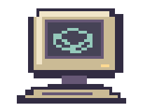

        
        
TypeScript · React · Three.js · React Three Fiber

        
<a href="https://zivko.dev">Explore my portfolio</a>

      

      
My portfolio as an explorable 3D scene, with an interactive retro terminal inside. A place to work on lighting, shaders, interaction, and the details that make the web feel different.

    </td>
  </tr>
  <tr>
    <td width="50%" valign="top">
      

        
<strong>Job Finder</strong> 

        
        
TypeScript · Next.js · SQLite · OpenRouter

      

      
My personal job-search tool. I built CV import and review, sourced discovery with fit explanations, and saved-job and application tracking with drafts and follow-ups.

    </td>
    <td width="50%" valign="top">
      

        
<strong>Minesweeper</strong> 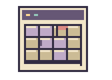

        
        
TypeScript · React · Redux Toolkit · WebSocket

        
<a href="https://github.com/Zileks/minesweeper/tree/main/src/app">Browse the TypeScript source</a>

      

      
Minesweeper is an earlier React project of mine. The board sends moves over a WebSocket and updates as the game server responds.

    </td>
  </tr>
</table>

### Client work

<table>
  <tr>
    <td width="50%" valign="top">
      

        
<strong>Mailody</strong> 

        
        
React · Python · FastAPI · Celery · Redis · PostgreSQL

      

      
Built analytics dashboards, attribution reporting, and async data pipelines. On the AI email product, I worked on customer profiling, campaign generation, and background workers.

    </td>
    <td width="50%" valign="top">
      

        
<strong>Gaiseo</strong> 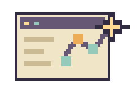

        
        
TypeScript · React · Node.js · PostgreSQL · Azure

      

      
Worked across the frontend, backend, and architecture: website crawling and scoring, LLM integrations, subscription flows, and Azure infrastructure.

    </td>
  </tr>
  <tr>
    <td width="50%" valign="top">
      

        
<strong>Conga</strong> 

        
        
TypeScript · JavaScript · React · Lit · Storybook

      

      
Developed an enterprise UI component library shared across products. I led reusable data-grid and table work, built React and Lit components, and documented their behavior in Storybook.

    </td>
    <td width="50%" valign="top">
      

        
<strong>Deepdays</strong> 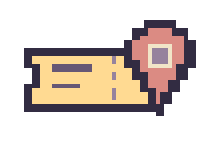

        
        
React · TypeScript · Capacitor · Google Maps API · MongoDB

      

      
Frontend and mobile work on Deepdays / ClubKit, with backend contributions. I built event and ticket screens, organizer tools, interactive partner maps, and Capacitor integrations for Android and iOS.

    </td>
  </tr>
</table>

## Tools I work with

From interfaces and background jobs to data, integrations, and delivery.

Open a group and select a tool to explore a project or my CV.

  
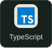 <strong>01 · Interfaces</strong> · TypeScript, JavaScript, React

  

    
    
    <a href="#project-conga">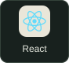</a>
    <a href="#project-cekira">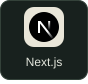</a>
    
    <a href="#project-conga">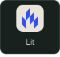</a>
    
    <a href="#project-cekira">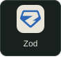</a>
  

  
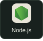 <strong>02 · Services &amp; background jobs</strong> · Node.js, Python, FastAPI

  

    
    <a href="#project-mailody">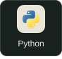</a>
    <a href="#project-mailody">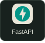</a>
    <a href="#project-gaiseo">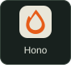</a>
    
    <a href="#project-cekira">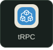</a>
    <a href="#project-mailody">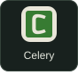</a>
  

  
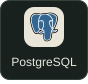 <strong>03 · Data &amp; models</strong> · PostgreSQL, MongoDB, Redis

  

    
    
    <a href="#project-mailody">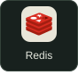</a>
    <a href="#project-cekira">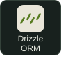</a>
    
    
    
  

  
 <strong>04 · APIs &amp; integrations</strong> · Stripe, Clerk, REST APIs

  

    
    <a href="#project-cekira">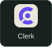</a>
    <a href="https://zivko.dev/resume.pdf">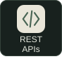</a>
    
    <a href="#project-cekira">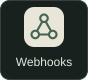</a>
    <a href="#project-cekira">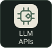</a>
    <a href="#project-cekira">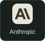</a>
    <a href="#project-cekira">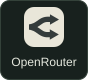</a>
  

  
 <strong>05 · Delivery &amp; operations</strong> · Docker, GitHub Actions, Terraform

  

    
    <a href="#project-cekira">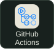</a>
    <a href="#project-gaiseo">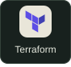</a>
    <a href="#project-gaiseo">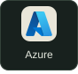</a>
    
    
    <a href="#project-mailody">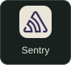</a>
  

  
 <strong>06 · Testing</strong> · Playwright, pytest

  

    
    <a href="#project-mailody">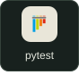</a>
  

  
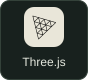 <strong>07 · Creative web &amp; mobile</strong> · Three.js, React Three Fiber, Capacitor

  

    
    
    <a href="#project-deepdays">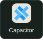</a>
    <a href="#project-deepdays">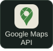</a>
  

  
 <strong>More project integrations</strong> · Gmail, Linear, Klaviyo

  

    
    <a href="#project-cekira">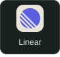</a>
    <a href="#project-mailody">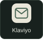</a>
    
    
    <a href="#project-gaiseo">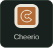</a>
  

  
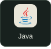 <strong>Earlier work</strong> · Java, Spring Boot

  

    
    
  

---

Based in Serbia · Working remotely · Open to new roles  
[Let's talk](mailto:contact@zivko.dev) · [Explore my portfolio](https://zivko.dev)

<!-- Refresh .preview/profile-readme.html whenever the README or its assets change. -->
